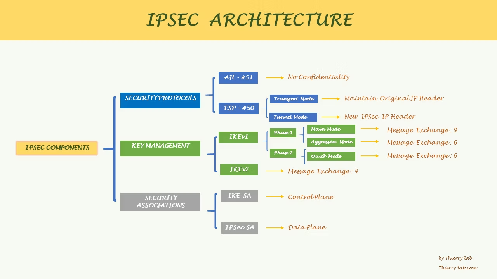

# IPSec Architecture

IP Security commonly known as IPsec addresses the challenges of sending information securely over an unsecure transport IP network, such as the public internet.

## MAIN Focus

IPsec guarantees confidentiality by using encryption, data integrity using hashing algorithm to detect any modification made to the data in transit, authentication by using pre-shared key or digital signature to properly identify authorized peer, and anti-reply by assigning and tracking the unique sequence number of the IPsec packets.

## Componeents

https://static.wixstatic.com/media/c7820a_d7e7c71de50041d397e826b813e2df2e~mv2.png/v1/fill/w_1280,h_720,al_c,q_90,enc_auto/c7820a_d7e7c71de50041d397e826b813e2df2e~mv2.png
